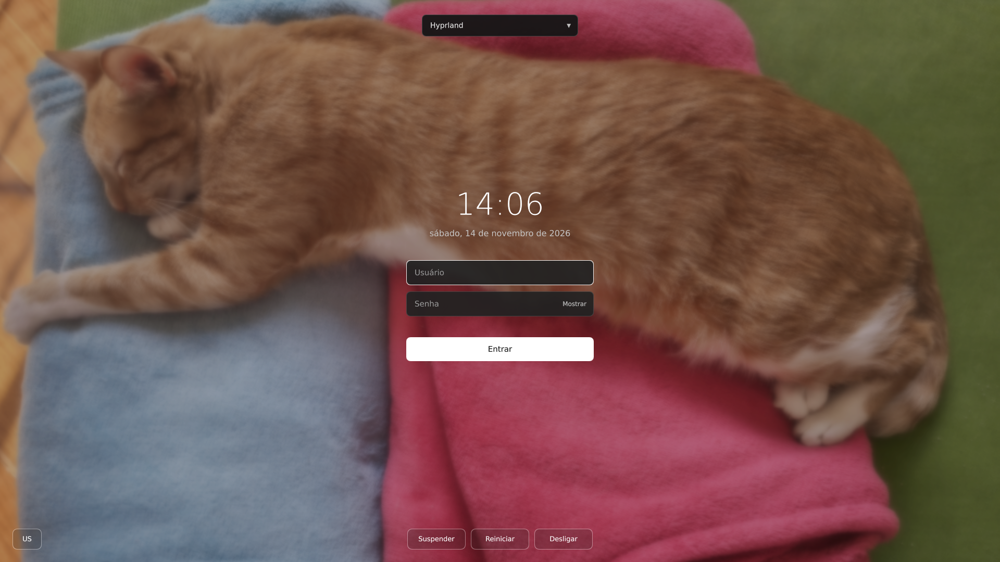

# Basic Center — SDDM Theme

Tema SDDM simples e limpo:



## Baixar:
```bash
cd ~/
git clone https://github.com/luracore/simple-sddm
```

## Instalar:
```bash
sudo rm -rf /usr/share/sddm/themes/simple-sddm
sudo cp -a ~/simple-sddm /usr/share/sddm/themes/simple-sddm
```

## Personalizar o wallpaper

Coloque suas imagens (`.png`, `.jpg`, `.jpeg`, `.webp`) na pasta:

```bash
~/simple-sddm/wallpapers/
```

A cada vez que a tela de login abre, uma delas é sorteada. Para usar sempre a mesma imagem, deixe `WallpaperFolder=` vazio no `theme.conf` e aponte `Background=` para o arquivo desejado.

Depois, realize novamente a etapa da instalação para copiar os wallpapers para o diretório do SDDM.

## Configurar SDDM:

Em `/etc/sddm.conf` coloque:

```ini
[Theme]
Current=simple-sddm
```

## Testar sem reiniciar o computador

```bash
sddm-greeter-qt6 --test-mode --theme /usr/share/sddm/themes/simple-sddm
```
